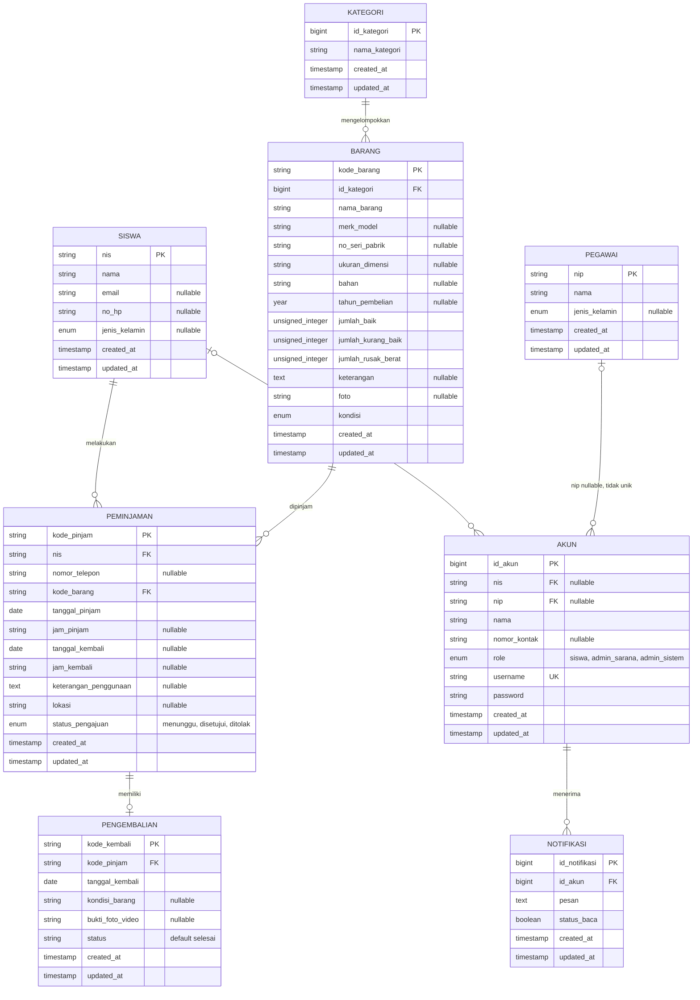

# Entity Relationship Diagram

Diagram ini merepresentasikan struktur database aktual berdasarkan seluruh
migrasi aplikasi, bukan relasi yang hanya didefinisikan pada model Eloquent.

## Catatan kardinalitas dan batasan

- Setiap peminjaman harus memiliki tepat satu siswa dan satu barang. Siswa atau
  barang dapat belum pernah atau sudah berkali-kali muncul pada transaksi.
- Satu peminjaman dapat belum memiliki pengembalian atau memiliki paling banyak
  satu pengembalian. Kolom `pengembalian.kode_pinjam` adalah foreign key unik.
- Satu barang harus berada dalam satu kategori; satu kategori dapat memiliki
  banyak barang.
- `akun.nis` dan `akun.nip` nullable dan tidak diberi unique constraint.
  Karena itu, skema saat ini mengizinkan satu siswa/pegawai direferensikan oleh
  beberapa akun, dan satu akun dapat tidak terhubung ke salah satu atau bahkan
  terhubung ke keduanya. Diagram menunjukkan aturan database ini, bukan dugaan
  hubungan satu-ke-satu.
- `akun.role` tidak memiliki constraint yang mewajibkan akun `siswa` mengisi
  `nis`, atau akun admin mengisi `nip`. Jika setiap profil memang harus punya
  maksimal satu akun dan jenis akun harus cocok dengan profilnya, tambahkan
  unique constraint pada `akun.nis` dan `akun.nip` serta validasi konsistensi
  role/FK melalui skema aplikasi atau database.
- Peminjaman saat ini hanya menyimpan `nis`, sehingga guru/pegawai tidak dapat
  menjadi peminjam menurut skema yang berlaku.
- Foreign key `peminjaman.kode_barang` dan `pengembalian.kode_pinjam` memakai
  cascade delete. Menghapus barang akan menghapus riwayat pinjaman dan
  pengembaliannya; jika riwayat perlu dipertahankan, gunakan soft delete atau
  larang penghapusan barang yang pernah dipinjam.
- Catatan implementasi: foreign key `peminjaman.nis` menunjuk `siswa.nis`, tetapi
  relasi `Peminjaman::siswa()` saat ini menunjuk model `Akun`. Relasi model itu
  tidak sesuai dengan foreign key dan sebaiknya dipisahkan menjadi relasi ke
  `Siswa` dan relasi akun jika informasi akun juga diperlukan.
- Tabel framework seperti `personal_access_tokens`, `failed_jobs`, dan tabel
  reset password tidak ditampilkan karena diagram ini fokus pada domain
  peminjaman fasilitas.
